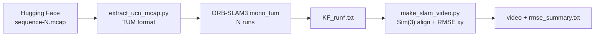

# UCU SLAM Toolkit

We run ORB-SLAM3 (Monocular) on the UCU SLAM Dataset. We compare the result with GNSS and make a video. Built from [`ucu-ai-course/project-template`](https://github.com/ucu-ai-course/project-template).

## Demo

The video shows the camera frame on the left. On the right there is a map from the top. The gray line is GNSS. Each color line is one ORB-SLAM3 run.

```bash
./run_sequence.sh 1    # the video is saved to results/seq1/seq1_all_runs.mp4
```

## Team

| Name | GitHub | Role |
|---|---|---|
| Maxym Hobela | TODO | ORB-SLAM3 build and runs |
| TODO Hapiuk | TODO | DSO vs ORB-SLAM3 benchmark on TUM, .mcap tools |

## Problem and motivation

A robot must know where it is. GNSS does not always work well. A camera is cheap. We want to check how well ORB-SLAM3 works with one camera on a real robot. We test it in the UCU campus and in Stryiskyi park. We test it in the day and in the evening.

## Data

UCU SLAM Dataset v1 on Hugging Face: [`ucu-autonomous-ugv/ucu-slam-dataset-v1`](https://huggingface.co/datasets/ucu-autonomous-ugv/ucu-slam-dataset-v1). It has 13 sequences. Each sequence is a ROS 2 `.mcap` file. The camera is Intel RealSense D435 (640x480, 30 fps).

Access is closed. Accept the terms on the dataset page. Make a **Read** token in Settings. Data is not in this repo.

| N | Route | Light |
|---|---|---|
| 1 | Church loop, campus | day |
| 2 / 3 | Middle loop, campus (3 is reverse) | day |
| 4 / 5 | Figure eight, campus | 4 day, **5 evening** |
| 6 / 7 | Middle loop, park (7 is reverse) | day |
| 8 | Park loop | **evening** |
| 9 | Loop with height change, park | day |
| 10 | Figure eight, park | day |
| 11 / 12 | Line campus to park and back | day |
| 13 | Line campus to park | **evening** |

Day and evening pairs on the same route: 4 and 5, 6 and 8, 11 and 13.

## Approach



1. Download one sequence.
2. Convert `.mcap` to TUM format (`rgb/`, `rgb.txt`, `imu.txt`, `groundtruth.txt`). No ROS needed.
3. Run ORB-SLAM3 Monocular 5 times.
4. Align each run to GNSS with Sim(3) (Umeyama). Count ATE RMSE in the xy plane.
5. Make one video with all runs.

We use Monocular because depth in v1 is broken.

## Results

Sequence 1 (day), best run:

| Metric | Value |
|---|---|
| ATE RMSE 3D | 1.57 m |
| ATE RMSE xy | 1.11 m |
| Loop closed | no (drift about 4 m) |

Runs on the same data can be very different (seq 1: 1.1 m and 12.7 m). This is scale drift. So we make many runs and use the median.

Sanity check on TUM fr1_xyz (RGB-D): RMSE about 0.01 m. The build is OK.

### DSO vs ORB-SLAM3 on TUM fr1_desk

Both run as Monocular. ATE with Sim(3) alignment (`evo_ape -va --align -s`). Files are in [`results/tum_fr1_desk/`](results/tum_fr1_desk/).

| Method | Poses | ATE RMSE | ATE max | Scale correction |
|---|---|---|---|---|
| **ORB-SLAM3** (keyframes) | 142 | **0.020 m** | 0.097 m | 0.978 |
| DSO | 217 | 0.635 m | 1.234 m | 0.629 |

ORB-SLAM3 is about 30 times more accurate here. DSO also has a big scale error.

## Quick start

All commands run in Ubuntu (WSL on Windows or Linux).

```bash
sed -i 's/\r$//' *.sh scripts/*.sh   # only if the files came through Windows
chmod +x *.sh scripts/*.sh
./setup.sh                           # Python venv, evo, Hugging Face client
hf auth login --token hf_YOUR_TOKEN
./run_sequence.sh 1                  # sequence 1, 5 runs (about 1 hour)
./run_sequence.sh 5 3                # sequence 5, 3 runs
STEP=6 FIT=all ./run_sequence.sh 8   # video settings
```

You need ORB-SLAM3 in `~/ORB_SLAM3`. Build steps for Ubuntu 24.04 are in [`docs/ucu_slam_toolkit_uk.md`](docs/ucu_slam_toolkit_uk.md) (section 3.1). Check the build:

```bash
./scripts/sanity_check.sh            # fr1_xyz, expect PASS
```

Only video from ready runs (no ORB-SLAM3):

```bash
~/venvs/ucu/bin/python scripts/make_slam_video.py ~/datasets/ucu_seq1 seq1.mp4 results/seq1/KF_run*.txt
```

DSO vs ORB-SLAM3 on TUM (needs DSO in `/root/dso` and ORB-SLAM3 in `/root/ORB_SLAM3`):

```bash
python3 scripts/download_tum.py   # 5 TUM sequences to /root/project/Datasets/TUM
./scripts/run_benchmark.sh        # set SEQ_NAME and DATASET_PATH at the top first
```

Paths in these scripts are fixed (`/root/project` or `D:\huggingface\...`). Change them for your PC.

## Repository structure

```
.
├── setup.sh                     # one time setup: venv, evo, hf
├── run_sequence.sh              # full cycle for one sequence
├── scripts/
│   ├── extract_ucu_mcap.py           # .mcap to TUM format
│   ├── make_slam_video.py            # video + ATE RMSE
│   ├── sanity_check.sh               # ORB-SLAM3 test on TUM
│   ├── run_benchmark.sh              # DSO vs ORB-SLAM3 on one TUM sequence
│   ├── download_tum.py               # download 5 TUM sequences
│   ├── DSO_csv_normalize.py          # put real timestamps into DSO output (shell one-liner)
│   ├── convert_mcap_to_euroc.py      # UCU .mcap to EuRoC format (camera + IMU)
│   ├── inspect_mcap.py               # list topics in .mcap
│   ├── inspect_dataset.py            # topics, first frame, first IMU record
│   ├── extract_all_calib.py          # camera intrinsics and /tf_static from .mcap
│   └── generate_openvins_config.py   # camera to IMU extrinsics for OpenVINS
├── config/
│   ├── UCU_mono.yaml                 # D435 camera settings for ORB-SLAM3
│   └── camera_tum_fr1.txt            # TUM fr1 camera settings for DSO
├── results/
│   ├── seqN/                         # KF_run*.txt, run*.log, rmse_summary.txt, video
│   ├── tum_fr1_desk/                 # DSO and ORB-SLAM3 trajectories, evo reports, logs
│   └── figures/ucu_seq1_first_frame.jpg
└── docs/ucu_slam_toolkit_uk.md       # full guide in Ukrainian
```

Other folders come from the template.

## Reproducibility

- **OS**: Ubuntu 24.04 in WSL2 on Windows 11. gcc 13.
- **ORB-SLAM3**: UZ-SLAMLab master with C++14. Pangolin v0.8.
- **Camera settings**: from the dataset `calibration.yaml` (Kalibr, pinhole + radtan). 1500 ORB features.
- **Ground truth**: GNSS without RTK. Only position. Error is a few meters. Height is the worst. So we use xy.
- **Random**: ORB-SLAM3 is not deterministic. Make 5 runs.
- **Runtime**: 5 to 15 minutes for one run. The build takes 1 to 2 hours.

## Development

```bash
flake8 scripts/ && black --check scripts/ && isort --check scripts/
```

Common problems:

| Problem | Fix |
|---|---|
| Build stops with `Killed` | Not enough memory. Add swap in `.wslconfig`. Use `make -j1`. |
| `Illegal header value b'Bearer '` | Use `hf auth login --token hf_...` |
| `Too few matched poses` | The run was broken. Run it again. |
| `KF_run*.txt` is almost empty in the evening | ORB-SLAM3 did not start tracking. This is a result. |
| The video does not open | Use VLC. |

## AI usage

| Tool | Used for | How we checked |
|---|---|---|
| Claude | Help with ORB-SLAM3 build on Windows 11 (WSL), scripts and this README | We ran the build and scripts. The numbers come from our runs. |

## Contribution statement

| Member | Contribution | Responsible for |
|---|---|---|
| Maxym Hobela | 50% | TODO |
| TODO Hapiuk | 50% | TODO |

## License and citation

| | License |
|---|---|
| Code | MIT, see [`LICENSE`](LICENSE) |
| Data | Terms of the UCU SLAM Dataset on Hugging Face |
| ORB-SLAM3 | GPLv3 (not in this repo) |

See [`CITATION.cff`](CITATION.cff).

## Acknowledgments

Thanks to UZ-SLAMLab for ORB-SLAM3. Thanks to the UCU autonomous UGV team for the dataset. Thanks to the course team.
