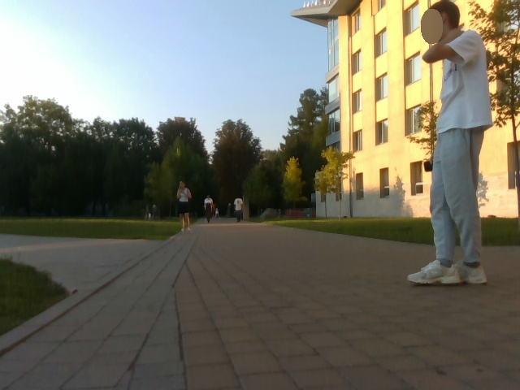
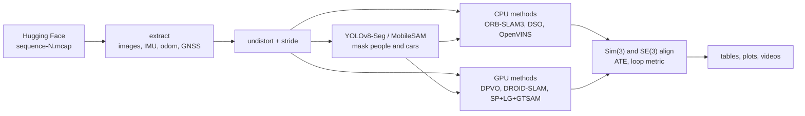

# SLAM Benchmark on the UCU Campus Dataset

We compare modern SLAM methods on the UCU SLAM Dataset. The robot drives in the campus and in Stryiskyi park. Some routes are in the evening. We want to see how the methods work outside and in low light. Built from [`ucu-ai-course/project-template`](https://github.com/ucu-ai-course/project-template).

## Demo

For each sequence and method the benchmark saves a top view plot (`trajectory.png`) and a video (`trajectory.mp4`). The black line is GNSS. The red line is the SLAM estimate.



## Team

| Name | GitHub |
|---|---|---|
| Maxym Hobela | https://github.com/MaksHobela/ |
| TODO Hapiuk | https://github.com/olkaleska/ |

Stakeholders: UCU Autonomous UGV Club (UCU APPS), Oleksandr Kosovan, Yaroslav Prytula.

## Problem and motivation

A robot must know where it is. GNSS is not always good. Under trees and in the evening it is even harder. Many SLAM methods exist, but there is no fair test on our own campus data. We want a benchmark that anyone can run again. The style is like Newer College, Hilti and KITTI.

## Data

UCU SLAM Dataset v1 on Hugging Face: [`ucu-autonomous-ugv/ucu-slam-dataset-v1`](https://huggingface.co/datasets/ucu-autonomous-ugv/ucu-slam-dataset-v1).

- 13 sequences: campus, park and mixed
- ROS 2 `.mcap` files, 6 to 11 GB each
- RealSense D435 color camera (640x480, 30 fps), IMU (125 Hz), wheel odometry, GNSS
- Ground truth is GNSS without RTK. Only position. Error is a few meters.
- Depth in v1 is broken. We do not use it.
- Evening sequences: 5, 8 and 13. Pairs with the same route: 4 and 5, 6 and 8, 11 and 13.

Access is closed. Accept the terms on the dataset page and make a Read token. Data is not in this repo.

## Approach



Methods:

- **ORB-SLAM3** (Mono): classic feature based SLAM. The main baseline.
- **DSO**: direct method. Second classic baseline.
- **OpenVINS**: visual inertial. Uses the IMU.
- **DPVO** and **DROID-SLAM**: deep learning methods (GPU).
- **SuperPoint + LightGlue + GTSAM**: our own pipeline. Learned features, scale from wheel odometry, pose graph with loop closures.
- **YOLOv8-Seg / MobileSAM + method**: we hide people and cars before SLAM. Does it help?
- **DSO + OpenVINS**: our simple fusion. DSO gives the shape. OpenVINS gives the scale.

Why these: they cover feature based, direct, visual inertial and deep methods. All have open code.

Metrics:

- ATE RMSE, mean and max after Sim(3) alignment (no scale)
- ATE RMSE after SE(3) alignment (real scale)
- Horizontal ATE (xy), because GNSS height is bad
- Loop quality: when GNSS shows the robot is at the same place again, how far apart is the estimate?
- Coverage: which part of the route has an estimate
- Runtime

## Results

No final results yet. We only have smoke tests from `slam_02_run_benchmark.ipynb`.

Sequence 1: only **SuperPoint + LightGlue + GTSAM** gave a trajectory.

- ATE RMSE 1.43 m (Sim3), 1.50 m (SE3)
- ATE max 2.86 m
- Runtime 170 s

Other methods on sequence 1 have no result yet.

Sequence 12: no method gave a trajectory.

- ORB-SLAM3: exit code 1
- DSO: exit code -11 (segmentation fault)
- OpenVINS: "no static tf between imu and camera_color"
- DPVO: timeout
- DROID-SLAM: exit code 1
- SuperPoint + LightGlue + GTSAM: error

We do not know the causes yet. The run on all 13 sequences stopped at sequence 2.

[`results/tum_fr1_desk/`](results/tum_fr1_desk/) has a first trial of DSO and ORB-SLAM3 on the TUM dataset.

## Quick start

Main benchmark (Google Colab with GPU, Google Drive):

1. Add a Colab secret `hf` with your Hugging Face token.
2. Run [`notebooks/slam_01_build_once.ipynb`](notebooks/slam_01_build_once.ipynb) one time (40 to 70 min). It builds all methods and saves them to Drive in `slam_bench/builds/`.
3. Run [`notebooks/slam_02_run_benchmark.ipynb`](notebooks/slam_02_run_benchmark.ipynb). First try one sequence (`SEQS = [1]`). Then all 13.

Results go to Drive: `slam_bench/results/seq-N/<method>/` (`traj_tum.txt`, `metrics.json`, `status.json`, `run.log`, `trajectory.png`, `trajectory.mp4`). A second run skips what is done.

Local ORB-SLAM3 in WSL (Ubuntu):

```bash
sed -i 's/\r$//' *.sh scripts/*.sh
chmod +x *.sh scripts/*.sh
./setup.sh
hf auth login --token hf_YOUR_TOKEN
./scripts/sanity_check.sh            # ORB-SLAM3 test on TUM fr1_xyz
./run_sequence.sh 1                  # sequence 1, 5 runs, video
```

DSO vs ORB-SLAM3 on TUM, locally (same script as in Colab, paths are found automatically):

```bash
bash scripts/build_dso.sh            # build DSO without GUI into ~/dso (one time)
bash scripts/run_benchmark.sh        # fr1_desk from ~/datasets, results in results/
```

Full guide in Ukrainian: [`docs/ucu_slam_toolkit_uk.md`](docs/ucu_slam_toolkit_uk.md).

## Repository structure

```
.
├── notebooks/
│   ├── slam_01_build_once.ipynb      # build all SLAM methods in Colab (one time)
│   └── slam_02_run_benchmark.ipynb   # run the benchmark on all sequences
├── src/slam_bench/
│   ├── slam_common.py                # data, metrics, plots, tables
│   ├── slam_pipelines.py             # one function per method
│   ├── slam_run.py                   # runs everything in parallel
│   └── run_droid.py                  # DROID-SLAM without GUI
├── setup.sh, run_sequence.sh         # local ORB-SLAM3 in WSL
├── scripts/
│   ├── extract_ucu_mcap.py           # .mcap to TUM format
│   ├── make_slam_video.py            # video + ATE
│   ├── sanity_check.sh               # ORB-SLAM3 test on TUM
│   ├── run_benchmark.sh              # DSO vs ORB-SLAM3 on TUM
│   ├── download_tum.py               # download TUM sequences
│   ├── DSO_csv_normalize.py          # real timestamps for DSO output (shell one-liner)
│   ├── convert_mcap_to_euroc.py      # .mcap to EuRoC format
│   ├── inspect_mcap.py               # list topics
│   ├── inspect_dataset.py            # topics, first frame, first IMU record
│   ├── extract_all_calib.py          # camera and /tf_static from .mcap
│   └── generate_openvins_config.py   # camera to IMU transform for OpenVINS
├── config/
│   ├── UCU_mono.yaml                 # D435 settings for local ORB-SLAM3
│   └── camera_tum_fr1.txt            # TUM camera for DSO
├── results/
│   ├── tum_fr1_desk/                 # first TUM trial
│   └── figures/
└── docs/ucu_slam_toolkit_uk.md       # local guide in Ukrainian
```

Built binaries (about 470 MB) are not in git. They live on Google Drive. Other folders come from the template.

## Reproducibility

- **Platform**: Google Colab, GPU T4 / L4 / A100, Python 3.13.
- **Builds**: ORB-SLAM3 without `-march=native`, DSO without GUI, OpenVINS v2.7 without ROS, DPVO and DROID-SLAM as wheels.
- **Inputs**: undistorted images. Every 2nd frame for most methods, every 6th for DROID-SLAM and GTSAM.
- **Settings**: all in `CFG` in `src/slam_bench/slam_pipelines.py`.
- **Ground truth**: GNSS is never used inside the methods. Only for evaluation.
- **Limits**: Colab time is limited. Each method has a time budget per sequence.

## Development

```bash
flake8 src/ scripts/ && black --check src/ scripts/ && isort --check src/ scripts/
```

Things to check (not confirmed):

| Problem | Note |
|---|---|
| OpenVINS: no static tf | The code looks for `imu` and `camera_color`. `generate_openvins_config.py` uses `base_link` and `color`. Maybe the names do not match. |
| IMU noise | `CFG['imu_noise']` has generic values. Real values are in the dataset `calibration.yaml`. |
| DPVO / DROID weights | Our copies of `dpvo.pth` and `droid.pth` are 14 and 29 bytes with "404: Not Found" inside. Maybe the weights did not download. |
| VI-DSO | No official public code. Marked NOT_AVAILABLE. |

## AI usage

| Tool | Used for | How we checked |
|---|---|---|
| Claude | Help with builds in Colab and WSL, pipeline code and this README | Numbers in this README are copied from notebook output. Nothing else. |

## Contribution statement

| Member | Contribution | Responsible for |
|---|---|---|
| Maxym Hobela | 50% | TODO |
| TODO Hapiuk | 50% | TODO |

## License and citation

| | License |
|---|---|
| Code | MIT, see [`LICENSE`](LICENSE) |
| Data | Terms of the UCU SLAM Dataset on Hugging Face |
| SLAM methods | Their own licenses (ORB-SLAM3 and DSO are GPLv3). Not in this repo. |

See [`CITATION.cff`](CITATION.cff).

## Acknowledgments

Thanks to the UCU Autonomous UGV Club for the dataset. Thanks to Oleksandr Kosovan and Yaroslav Prytula. Thanks to the authors of all SLAM methods.
